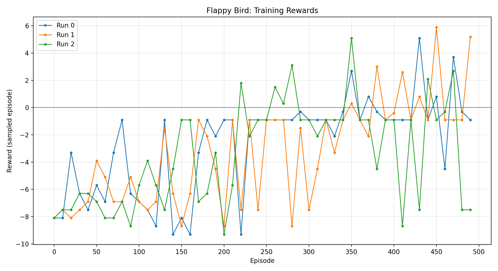

# Results - Flappy Bird Reinforcement Learning

## 1.1. Challenge Results

| Metric | Result |
|---|---:|
| Final reported result | 0.6646 |
| Challenge score | 84.1343 |
| Score thresholds passed | 4 |
| Next threshold | 120.0 |

The solution was evaluated by the ETH CodeExpert challenge framework.

## 1.2. Training Reward Curve

The plot shows episode rewards sampled during training
across three runs. Rewards fluctuate considerably between
episodes and runs, indicating variability in training.

## 2. Evaluation Across Runs

| Run | Training time | Evaluation time | Average score |
|---:|---:|---:|---:|
| 0 | 65 s | 1 s | -1.21 |
| 1 | 64 s | 33 s | 262.67 |
| 2 | 62 s | 1 s | -9.06 |

Each run trained for 500 episodes.

The evaluation results varied substantially between runs, indicating that performance was not consistent across all evaluations.

## 3. Training Configuration

- **Algorithm:** Neural-network-based one-step Q-learning
- **Framework:** PyTorch
- **Environment:** Flappy Bird Gymnasium
- **Network:** Fully connected neural network with two hidden layers of 64 units each
- **Input:** 12-dimensional observation vector
- **Output:** Q-values for two possible actions
- **Optimizer:** Adam
- **Learning rate:** 0.001
- **Discount factor:** 0.99
- **Exploration:** Epsilon-greedy policy, decaying from 1.0 to a minimum of 0.01
- **Training duration:** 500 episodes per run

The implementation uses one-step temporal-difference updates without an experience replay buffer or a separate target network.

## 4. Observations

- Training took approximately 62–65 seconds per run.
- Rewards generally improved during some portions of training, but individual episode rewards remained variable.
- The evaluation scores differed considerably across runs.
- Further investigation is needed to understand the variation in evaluation performance and improve consistency.

## 5. Potential Improvements

- Evaluate the trained policy over multiple episodes and report mean and standard deviation.
- Plot a moving average of training rewards to make learning trends easier to assess.
- Investigate training stability and sensitivity to random initialization.
- Compare different exploration schedules and training durations.

## 6. Limitations

The results above are taken from the CodeExpert log. The available output does not establish why the evaluation scores differ so much between runs, or whether the final reported result corresponds to a particular run or aggregation procedure.
